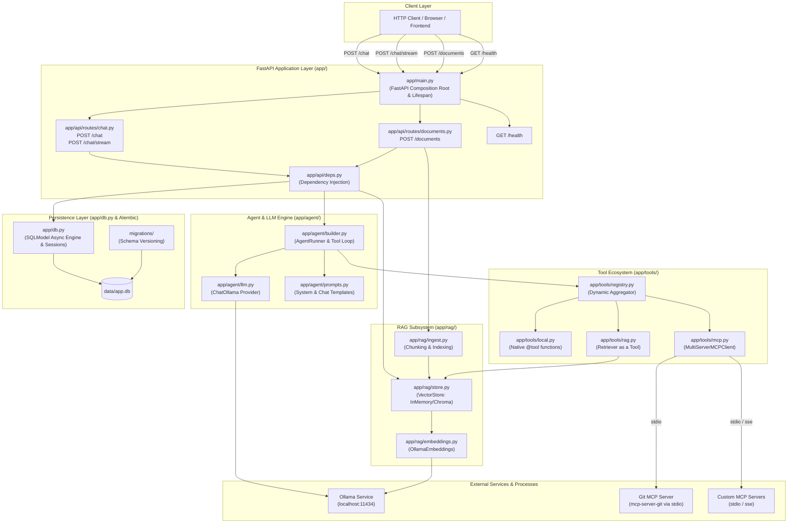
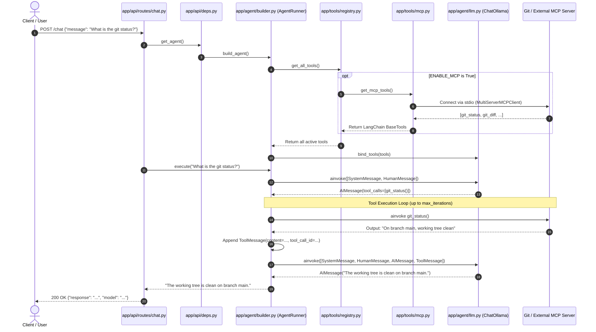
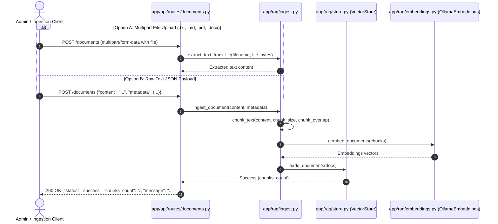

# System Architecture & Code Flow

This document details the architectural design, module responsibilities, and runtime execution flow for the AI Agent service.

---

## 1. High-Level System Architecture

---

## 2. End-to-End Code Flow

### 2.1 Chat Request Flow (with Tool Calling)

The sequence diagram below illustrates what happens from the moment a client sends a message to `/chat` until the model responds (including automatic MCP or local tool invocation):

---

### 2.2 RAG Ingestion & Retrieval Flow

When document indexing and knowledge base retrieval are enabled (`ENABLE_RAG=True`), `POST /documents` supports both **raw JSON text** and **multipart file uploads** (`.txt`, `.md`, `.pdf`, `.docx`) in a single route:

---

## 3. Directory & File Breakdown

### 3.1 Root Files

| File                           | Purpose                                                                                                 |
| :----------------------------- | :------------------------------------------------------------------------------------------------------ |
| **`mcp_servers.json`** | Standard multi-platform MCP configuration. Holds server commands, arguments, and environment variables. |
| **`pyproject.toml`**   | Standard PEP 621 packaging and dependency metadata.                                                     |
| **`requirements.txt`** | Pinned dependencies for virtual environment reproducibility.                                            |
| **`Makefile`**         | CLI workflows: `make dev`, `make start`, `make test`, `make migrate`.                           |
| **`alembic.ini`**      | Alembic CLI configuration pointing to `migrations/` and database URL.                                 |
| **`.env.sample`**      | Sample environment variables for developer configuration.                                               |
| **`ARCHITECTURE.md`**  | System architecture diagrams and technical specifications.                                              |
| **`README.md`**        | Overview, setup guide, and endpoint documentation.                                                      |

---

### 3.2 Application Source Code (`app/`)

#### Core Configuration & Application Lifespan

- **`app/main.py`**:
  Application factory (`build_app()`). Wires FastAPI, manages asynchronous startup/shutdown lifespan (`init_db`), mounts `/health`, `/chat`, `/chat/stream`, and `/documents`.
- **`app/config.py`**:
  Typed application configuration powered by Pydantic's `BaseSettings`. Reads environment variables and flags (`ENABLE_RAG`, `ENABLE_TOOLS`, `ENABLE_MCP`, `MCP_CONFIG_PATH`).
- **`app/db.py`**:
  SQLModel database session provider. Sets up the async SQLAlchemy engine, handles SQLite/PostgreSQL connections, and exposes the `get_session()` dependency with `expire_on_commit=False`.

#### API Presentation Layer (`app/api/`)

- **`app/api/deps.py`**:
  FastAPI dependency injection providers: yields database sessions (`get_db_session`), assembles the agent runner (`get_agent`), and retrieves the vector store (`get_vector_store_dep`).
- **`app/api/routes/chat.py`**:
  Single centralized chat route. Handles both synchronous JSON replies (`POST /chat`) and Server-Sent Events token streaming (`POST /chat/stream`).
- **`app/api/routes/documents.py`**:
  Unified RAG document ingestion route (`POST /documents`). Supports both raw text payloads (`application/json`) and file uploads (`multipart/form-data`) in a single route. Extracts, chunks, and stores documents when `ENABLE_RAG=True`.

#### Agent & Model Orchestration (`app/agent/`)

- **`app/agent/llm.py`**:
  Instantiates the LangChain chat model (`ChatOllama`) configured with model name, base URL, and temperature.
- **`app/agent/builder.py`**:
  `AgentRunner` class. Builds prompt sequences (`SystemMessage` + `HumanMessage`), binds tools, and executes the multi-turn tool calling loop for both synchronous turns (`execute()`) and token streaming (`execute_stream()`) with optional tool status notices.
- **`app/agent/prompts.py`**:
  Default system prompts and `ChatPromptTemplate` structures.

#### Tooling Subsystem (`app/tools/`)

- **`app/tools/registry.py`**:
  Central aggregator (`get_all_tools()`). Checks feature flags and dynamically combines native local tools, RAG retriever tools, and external MCP tools into a unified list.
- **`app/tools/local.py`**:
  Native Python functions decorated with `@tool` (e.g. `get_current_time`, `calculate_expression`).
- **`app/tools/mcp.py`**:
  Model Context Protocol client adapter. Parses `mcp_servers.json`, connects to external servers via `MultiServerMCPClient`, and returns remote tools as LangChain tools.
- **`app/tools/rag.py`**:
  `search_knowledge_base` `@tool` wrapping the vector store retriever, allowing the agent to perform semantic searches over indexed documents.

#### Retrieval-Augmented Generation (`app/rag/`)

- **`app/rag/store.py`**:
  Vector store provider. Initializes an `InMemoryVectorStore` (swappable with Chroma or FAISS) and exposes singleton retrieval helpers.
- **`app/rag/ingest.py`**:
  Document text extraction (`extract_text_from_file` supporting text/markdown, PDF via `pypdf`, and Word `.docx` via standard XML parsing), text chunking (`chunk_text`), and vector store indexing (`ingest_document`).
- **`app/rag/embeddings.py`**:
  Embeddings provider wrapping LangChain's `OllamaEmbeddings`.

#### Data Transfer Objects & Schemas (`app/schemas/`)

- **`app/schemas/chat.py`**:
  Pydantic models for chat requests (`ChatRequest`), responses (`ChatResponse`), document ingestion (`DocumentIngestRequest`, `DocumentIngestResponse`), and health status.
- **`app/schemas/mcp.py`**:
  Strict schema models (`MCPServerConfig`, `MCPConfigFile`) validating `stdio` and `sse` MCP configurations, performing environment variable expansions, and enforcing platform standards.

---

## 4. Key Architectural Design Principles

1. **Standardized Protocol over Custom Protocols**:
   Uses the official **Model Context Protocol (MCP)** specification via `langchain-mcp-adapters` instead of building custom tool execution engines from scratch.
2. **Declarative Configuration**:
   MCP servers are added declaratively via `mcp_servers.json` without modifying Python code.
3. **Pluggable Feature Flags**:
   Tools, RAG, and MCP can each be toggled on or off independently via boolean flags (`ENABLE_TOOLS`, `ENABLE_RAG`, `ENABLE_MCP`).
4. **Thin Web Layer**:
   FastAPI routes contain zero business logic; they validate DTO schemas, resolve dependencies, and delegate execution to `AgentRunner` or `ingest_document`.
5. **Robust Database Migrations**:
   Schema evolution is managed through Alembic async migrations (`alembic upgrade head`) referencing `SQLModel.metadata`.
