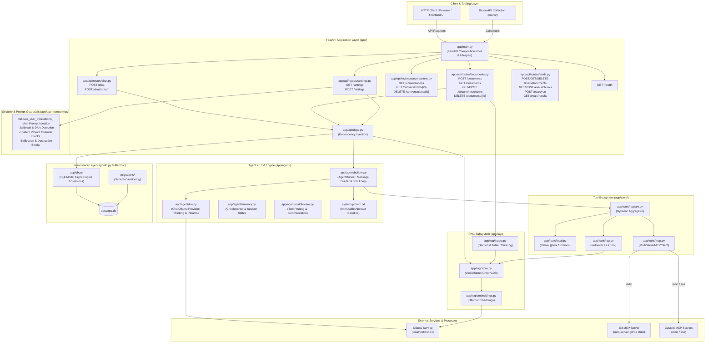
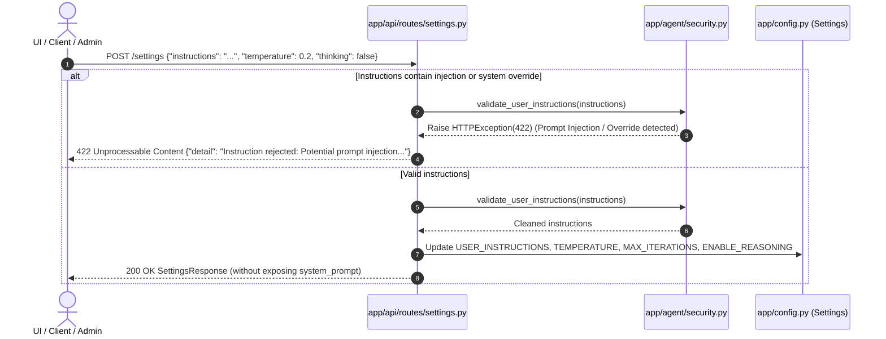
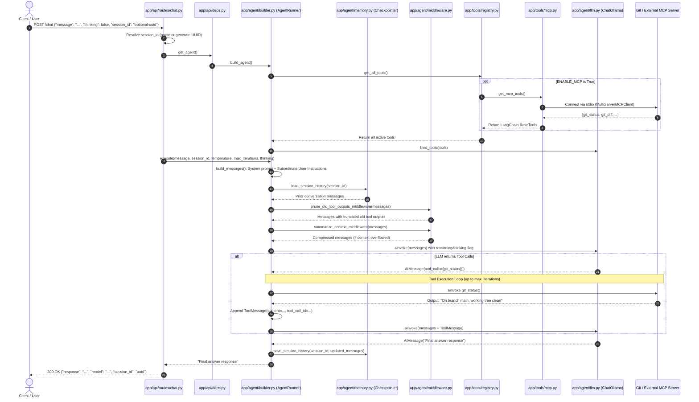
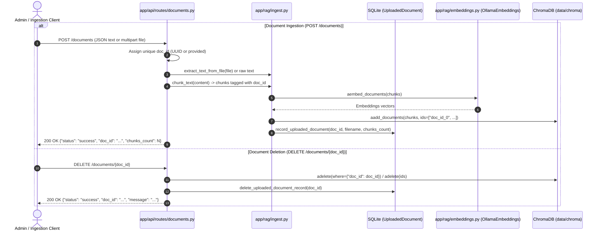

# System Architecture & Code Flow

This document details the architectural design, module responsibilities, security boundaries, and runtime execution flow for the AI Agent service.

---

## 1. High-Level System Architecture

---

## 2. End-to-End Code Flow

### 2.1 Settings Configuration & Security Validation Flow

The `/settings` route provides dynamic runtime configuration for UI layers and clients while enforcing strict security boundaries over the abstract system prompt and user instructions:

### 2.2 Chat Request Flow (with Instructions Hierarchy & Thinking Mode)

The sequence diagram below illustrates what happens from the moment a client sends a message to `/chat` or `/chat/stream` until the model responds (including prompt assembly, session checkpointer, middlewares, and automatic tool invocation):

---

### 2.2 RAG Ingestion, Retrieval & Deletion Flow

When document indexing and knowledge base retrieval are enabled (`ENABLE_RAG=True`), `POST /documents` supports both **raw JSON text** and **multipart file uploads** (`.txt`, `.md`, `.pdf`, `.docx`), assigning each upload a unique `doc_id`. Ingested chunks are tagged and persisted in **ChromaDB** on disk (`data/chroma`). In addition, `DELETE /documents/{doc_id}` allows clean, total removal of any document and its chunk vectors.

---

## 3. Directory & File Breakdown

### 3.1 Root Files

| File                           | Purpose                                                                                                 |
| :----------------------------- | :------------------------------------------------------------------------------------------------------ |
| **`system-prompt.txt`**        | Abstract, immutable system prompt defining agent identity, tool capabilities, and security boundaries.   |
| **`bruno/`**                   | Declarative OpenCollection API suite for testing and inspecting endpoints across all modules in Bruno.  |
| **`mcp_servers.json`**         | Standard multi-platform MCP configuration. Holds server commands, arguments, and environment variables. |
| **`pyproject.toml`**           | Standard PEP 621 packaging and dependency metadata.                                                     |
| **`requirements.txt`**         | Pinned dependencies for virtual environment reproducibility.                                            |
| **`Makefile`**                 | CLI workflows: `make dev`, `make start`, `make test`, `make migrate`.                                   |
| **`alembic.ini`**              | Alembic CLI configuration pointing to `migrations/` and database URL.                                   |
| **`.env.sample`**              | Sample environment variables for developer configuration.                                               |
| **`ARCHITECTURE.md`**          | System architecture diagrams and technical specifications.                                              |
| **`README.md`**                | Overview, setup guide, and endpoint documentation.                                                      |

---

### 3.2 Application Source Code (`app/`)

#### Core Configuration & Application Lifespan

- **`app/main.py`**:
  Application factory (`build_app()`). Wires FastAPI, manages asynchronous startup/shutdown lifespan (`init_db`, `init_checkpointer`), mounts `/health`, `/chat`, `/chat/stream`, `/conversations`, `/documents`, `/evals`, and `/settings`.
- **`app/config.py`**:
  Typed application configuration powered by Pydantic's `BaseSettings`. Reads environment variables and flags (`ENABLE_RAG`, `ENABLE_TOOLS`, `ENABLE_MCP`, `MCP_CONFIG_PATH`, `MODEL`, `TEMPERATURE`, `MAX_ITERATIONS`, `USER_INSTRUCTIONS`).
- **`app/db.py`**:
  SQLModel database session provider. Sets up the async SQLAlchemy engine, handles SQLite/PostgreSQL connections, and exposes the `get_session()` dependency with `expire_on_commit=False`.

#### API Presentation Layer (`app/api/`)

- **`app/api/deps.py`**:
  FastAPI dependency injection providers: yields database sessions (`get_db_session`), assembles the agent runner (`get_agent`), retrieves application settings (`get_settings`), and retrieves the vector store (`get_vector_store_dep`).
- **`app/api/routes/chat.py`**:
  Centralized chat routes. Handles both synchronous JSON replies (`POST /chat`) and Server-Sent Events token streaming (`POST /chat/stream`), accepting per-request runtime overrides (`temperature`, `max_iterations`, `thinking`, `stream_tools`).
- **`app/api/routes/settings.py`**:
  Settings and instruction management (`GET /settings`, `POST /settings`). Allows dynamic runtime updates for `instructions`, `temperature`, `max_iterations`, and `thinking` mode. Enforces that the baseline system prompt is immutable over the API and never exposed in API responses.
- **`app/api/routes/conversations.py`**:
  Conversation history routes (`GET /conversations`, `GET /conversations/{session_id}`, `DELETE /conversations/{session_id}`) listing active sessions with their auto-updated topic summary and last message timestamp.
- **`app/api/routes/documents.py`**:
  RAG document management routes (`POST /documents`, `GET /documents`, `GET /documents/chunks`, `POST /documents/query`, `DELETE /documents/{doc_id}`). Supports both raw text payloads and file uploads in a single route, chunk debugging/manual retrieval inspection, lists indexed documents, and allows clean deletion from ChromaDB and the database registry.
- **`app/api/routes/evals.py`**:
  Dedicated evaluation REST API (`/evals`) for dashboard panels: document ingestion (`POST /evals/documents`), document listing (`GET /evals/documents`), chunk retrieval inspection (`GET /evals/chunks`, `POST /evals/query`), deletion (`DELETE /evals/documents/{doc_id}`), benchmark execution (`POST /evals/run`), and latest results retrieval (`GET /evals/results`) operating strictly on isolated evaluation databases.

#### Agent & Model Orchestration (`app/agent/`)

- **`app/agent/security.py`**:
  Instruction sanitization and prompt injection guardrail (`validate_user_instructions`). Evaluates custom user instructions against jailbreak attempts (`DAN mode`, `developer mode`), safety filter bypasses, credential/secret exfiltration (`cat .env`, prompt leaks), and system prompt override directives before applying them to the runtime.
- **`app/agent/llm.py`**:
  Instantiates the LangChain chat model (`ChatOllama`) configured with model name, base URL, temperature, and thinking/reasoning flags.
- **`app/agent/builder.py`**:
  `AgentRunner` class. Builds prompt sequences (`SystemMessage` + `HumanMessage`), binds tools, combines abstract system prompt with subordinate user instructions, and executes the multi-turn tool calling loop for both synchronous turns (`execute()`) and token streaming (`execute_stream()`) with optional tool status notices.
- **`app/agent/prompts.py`**:
  Default system prompt templates and chat message schemas.
- **`app/agent/memory.py`**:
  Persistent conversation memory backed by LangGraph checkpointers (`AsyncSqliteSaver`) storing multi-turn history indexed by `session_id` in SQLite.
- **`app/agent/middleware.py`**:
  Custom agent middlewares:
  - `prune_old_tool_outputs_middleware`: Replaces previous turns' tool outputs with concise placeholders while keeping schema-valid tool call identifiers.
  - `summarize_context_middleware`: Compresses earlier conversation history when context size overflows, preserving key facts and recent messages.

#### Tooling Subsystem (`app/tools/`)

- **`app/tools/registry.py`**:
  Central aggregator (`get_all_tools()`). Checks feature flags and dynamically combines native local tools, RAG retriever tools, and external MCP tools into a unified list.
- **`app/tools/local.py`**:
  Native Python functions decorated with `@tool` (e.g. `get_current_time`, `calculate_expression`).
- **`app/tools/mcp.py`**:
  Model Context Protocol client adapter. Parses `mcp_servers.json`, connects to external servers via `MultiServerMCPClient`, and returns remote tools as LangChain tools.
- **`app/tools/rag.py`**:
  `search_knowledge_base` `@tool` wrapping the vector store retriever, allowing the agent to perform semantic searches over indexed documents.

#### Retrieval-Augmented Generation (`app/rag/`)

- **`app/rag/store.py`**:
  Persistent vector store provider backed by **ChromaDB** (`langchain-chroma`). Automatically persists embeddings to disk under `data/chroma/`, with dependency injection support for test overrides.
- **`app/rag/ingest.py`**:
  Document text extraction (`extract_text_from_file` supporting text/markdown, PDF via `pymupdf4llm` with table and Markdown layout extraction, `pdfplumber` structured table fallback, `pypdf`, and Word `.docx` with XML heading styles), section-aware text chunking (`chunk_text_by_sections` using subsection regex boundaries `split_subsections`, prepending heading breadcrumbs, and preserving Markdown table headers across chunk splits), vector store indexing with section metadata (`ingest_document`), and clean deletion (`delete_document_from_store`).
- **`app/rag/embeddings.py`**:
  Embeddings provider wrapping LangChain's `OllamaEmbeddings`.

#### Data Transfer Objects & Schemas (`app/schemas/` & `app/models/`)

- **`app/models/conversation.py`**:
  SQLModel table definition (`ConversationSession`) tracking `session_id`, auto-updated `summary`, `last_message_at`, `created_at`, and `message_count`.
- **`app/models/document.py`**:
  SQLModel table definition (`UploadedDocument`) tracking `doc_id`, `filename`, `source`, `chunks_count`, and `created_at`.
- **`app/schemas/chat.py`**:
  Pydantic models for chat requests (`ChatRequest`), responses (`ChatResponse`), document ingestion (`DocumentIngestRequest`, `DocumentIngestResponse`), document deletion (`DocumentDeleteResponse`, `UploadedDocumentItem`), conversation listings (`ConversationSessionItem`, `ConversationDetailResponse`), and health status.
- **`app/schemas/settings.py`**:
  Pydantic models for runtime settings updates (`SettingsUpdateRequest`) and configuration inspection (`SettingsResponse`).
- **`app/schemas/mcp.py`**:
  Strict schema models (`MCPServerConfig`, `MCPConfigFile`) validating `stdio` and `sse` MCP configurations, performing environment variable expansions, and enforcing platform standards.
- **`app/schemas/evals.py`**:
  Pydantic models for evaluation execution requests (`EvalRunRequest`), metrics summaries (`EvalMetricsSummary`), case outcomes (`EvalCaseResult`), and evaluation benchmark responses (`EvalRunResponse`).

#### Evaluation Subsystem (`eval/`)

- **`eval/test_cases.yaml`**:
  Declarative evaluation dataset containing seed knowledge base documents and question/reference answer test pairs with metadata and tags.
- **`eval/config.py`**:
  Evaluation configuration ensuring strict isolation with dedicated test databases (`data/eval/eval_app.db` and `data/eval/eval_chroma`).
- **`eval/dataset_loader.py`**:
  Loads YAML test cases and syncs dataset examples to LangSmith (`langsmith.Client`).
- **`eval/evaluators.py`**:
  LLM-as-a-judge evaluators for the 4 core RAG metrics:
  - **Correctness**: Compares agent output to reference answer.
  - **Answer Relevance**: Checks if the answer directly addresses the user question.
  - **Groundedness**: Verifies claims against retrieved context (hallucination detection).
  - **Retrieval Relevance**: Measures context precision of retrieved chunks.
- **`eval/runner.py`**:
  Orchestrates evaluation runs, outputs terminal summary tables, triggers LangSmith benchmarks, and exports reports to `eval/results/`.

---

## 4. Key Architectural Design Principles

1. **Standardized Protocol over Custom Protocols**:
   Uses the official **Model Context Protocol (MCP)** specification via `langchain-mcp-adapters` instead of building custom tool execution engines from scratch.
2. **Declarative Configuration**:
   MCP servers are added declaratively via `mcp_servers.json` without modifying Python code.
3. **Layered Instruction Hierarchy & Security Invariants**:
   The baseline system prompt is immutable over the API and loaded strictly from `system-prompt.txt`. User instructions can customize behavior and task execution, but are strictly subordinate to the system prompt and cannot override security rules or core capabilities.
4. **Active Prompt Injection Guardrails**:
   All user-provided instructions undergo strict regex and pattern verification (`app/agent/security.py`) to block prompt injections, jailbreaks, and data exfiltration attempts before execution.
5. **Pluggable Feature Flags**:
   Tools, RAG, and MCP can each be toggled on or off independently via boolean flags (`ENABLE_TOOLS`, `ENABLE_RAG`, `ENABLE_MCP`).
6. **Thin Web Layer**:
   FastAPI routes contain zero business logic; they validate DTO schemas, resolve dependencies, and delegate execution to `AgentRunner` or `ingest_document`.
7. **Robust Database Migrations**:
   Schema evolution is managed through Alembic async migrations (`alembic upgrade head`) referencing `SQLModel.metadata`.
