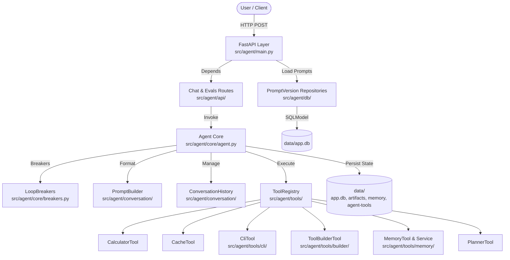

# AI Agent Architecture

## System Architecture

## Directory Layout & Boundaries

- **`src/agent/`**: Single unified top-level application package.
  - **`core/`**: Central reasoning loop (`Agent`), circuit breakers (`LoopBreakers`), and state definitions (`AgentState`, `Trace`).
  - **`conversation/`**: Chat history, message trimming, and prompt assembling (`PromptBuilder`).
  - **`tools/`**: `BaseTool` abstractions, `ToolRegistry`, and focused tools decomposed into single-responsibility collaborators.
  - **`api/`**: Thin FastAPI route controllers, schemas, and dependency injection providers.
  - **`db/`**: SQLModel schemas, async session creation, and database repositories.
  - **`prompts/`**: Externalized plain text prompt definitions (`system.txt`, `tools.txt`, `memory.txt`, `plan.txt`).
- **`data/`**: Git-ignored runtime state including SQLite database, project artifacts, memory text files, and custom dynamic tools.
- **`evals/`**: Evaluation suite decomposed into `cases/`, `layers/`, runner, reporter, and storage.
- **`tests/`**: Unit tests mirroring `src/agent/`.
